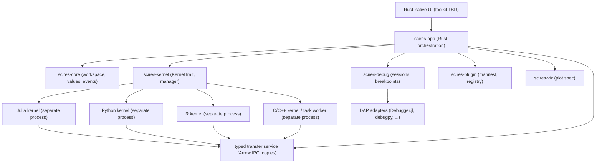
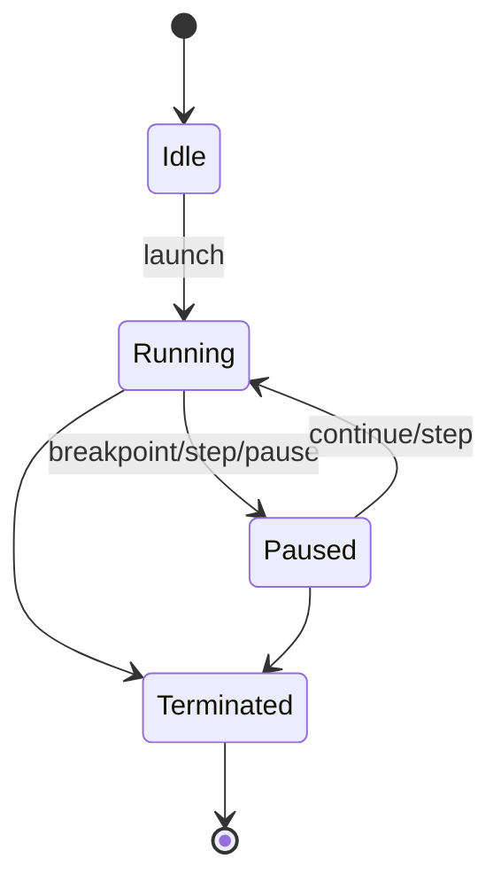

# SciRes Architecture

## 1. Principles

1. **Hexagonal / clean architecture** — domain crates have no knowledge of UI, IPC or
   language runtimes. Adapters implement traits defined in the domain.
2. **Rust-native IDE and orchestration** — the IDE shell and application orchestration
   are Rust. The native UI toolkit is not yet selected.
3. **Process isolation for language runtimes** — Julia, Python, R and C/C++ kernels run
   as separate long-lived processes. Compiled C/C++ tasks use isolated workers. A
   crashing worker never takes down the IDE.
4. **Versioned kernel boundary** — a versioned SciRes kernel API defines host/kernel
   capabilities. Jupyter-compatible messaging is used where it fits; small control
   messages use JSON or Protobuf.
5. **Everything is a plugin** — built-in language support is shipped as plugins using
   the same public API as third parties (VS Code / Eclipse / JupyterLab model).
6. **Event driven** — state changes publish `DomainEvent`s; UI views subscribe.

## 2. High-level view



## 3. Bounded contexts

| Context | Crate | Key concepts |
|---------|-------|--------------|
| Workspace | `scires-core` | `Workspace`, `Variable`, `Value`, `Language` |
| Execution | `scires-kernel` | `Kernel`, `KernelFactory`, `KernelManager`, `ExecuteRequest` |
| Debugging | `scires-debug` | `DebugSession`, `DebugState`, `Breakpoint`, `DebugAdapter` |
| Extensibility | `scires-plugin` | `PluginManifest`, `Contributions`, `PluginRegistry` |
| Visualization | `scires-viz` | `PlotSpec`, `Layer`, `Mark`, `Renderer` |

## 4. Polyglot model

Each language is a `Kernel` registered by a plugin through a `KernelFactory`. Rust
orchestrates a project workspace, but each kernel owns its own runtime state and variable
namespace. The workspace is not a shared variable namespace or shared heap: values move
between kernels only through explicit, typed transfer requests. `Value` summaries (type,
shape and preview) support the variable explorer; a summary is not the transferred data.

**Apache Arrow IPC is the preferred initial interchange representation.** Start with
copy-based transport. The initial transferable set is:

- Dense N-dimensional arrays of fixed-width numeric or Boolean values, with element type
  and shape metadata preserved.
- UTF-8 strings and rectangular tables whose columns use supported Arrow primitive types.
  Complex values are represented as a real/imaginary pair.
- Sparse values only when expressible as a typed coordinate (COO) table with explicit
  indices, values and shape metadata. Do not silently densify sparse data.

Custom/object values, ragged arrays, runtime objects and values without a defined mapping
remain kernel-local. They may be transferred only after an explicit user conversion;
otherwise the operation returns a clear unsupported-value error rather than silently
coercing data or sending a preview. Sparse formats that cannot be represented by the
coordinate form are likewise rejected. Detailed wire schemas, nullability rules, numeric
type coverage, memory order and conversion UX remain open.

Shared-memory Arrow buffers are deferred: any later adoption must follow benchmarks and
define buffer ownership, lifetime, cross-process cleanup and failure recovery first.
The experimental Python-only format comparison in `tests/bench_data_exchange.py` is
informational; it does not demonstrate SciRes or Julia interoperability.

The versioned SciRes kernel API (ADR-0008) is the compatibility boundary.
Jupyter-compatible messaging is used where it fits, with small JSON or Protobuf control
messages. Arrow IPC is the initial typed data representation rather than an implicit
shared namespace. Compiled C/C++ tasks run in isolated workers; the IDE must not load
arbitrary native libraries into its process.

## 5. Plugins

A plugin is a directory with a `scires-plugin.toml`:

```toml
id = "scires.python"
name = "Python support"
version = "0.1.0"
scires = "^0.1"
activation = ["onLanguage:python"]

[contributes]
kernels = ["python"]
commands = [{ id = "python.selectInterpreter", title = "Select Python interpreter" }]

[dependencies]
"scires.arrow" = "^0.1"
```

Lifecycle: `Installed → Enabled → Active → (Disabled | Failed)`. Activation is lazy
(VS Code-style activation events) to keep start-up fast.

Plugins declare a `runtime` — `declarative`, `native`, `wasm` (sandboxed, default for
third parties) or `process` — and may contribute dockable `views`. The full authoring
and build guide is [PLUGINS.md](PLUGINS.md) (ADR-0006).

## 5a. UI

`scires-ui` is a pure, toolkit-agnostic model of the shell: a dock `Layout`
(`left | center | right | bottom`) of `Panel`s and `Theme` design tokens. The default
`Layout::scientific()` mirrors Spyder/RStudio: Files · Editor · Variables/Plots ·
Console/Debugger. The UI must be Rust-native; the specific native toolkit remains open
(ADR-0007). The UI/UX prototype lives in Figma:
<https://www.figma.com/design/mX6AQKKVN9mkPeRU6v44k1> (Main Window, Plugin Manager),
with colour variables matching `Theme::dark()`.

## 6. Debugger

Modeled on Spyder/VS Code: the IDE is a DAP client; each language provides a DAP adapter.
`DebugSession` enforces a strict state machine:



## 7. Roadmap

1. ✅ Architecture & domain logic (this phase)
2. Versioned SciRes kernel API, Jupyter-compatible transport where applicable, and Julia
   kernel adapter
3. Explicit typed Arrow IPC transfers with copy-based transport and conversion errors
4. DAP client + Debugger.jl integration; isolated C/C++ task workers
5. Rust-native UI shell (toolkit TBD) with editor, console, variable explorer and plots
6. Plugin loading from disk and WASM sandboxing for untrusted plugins
