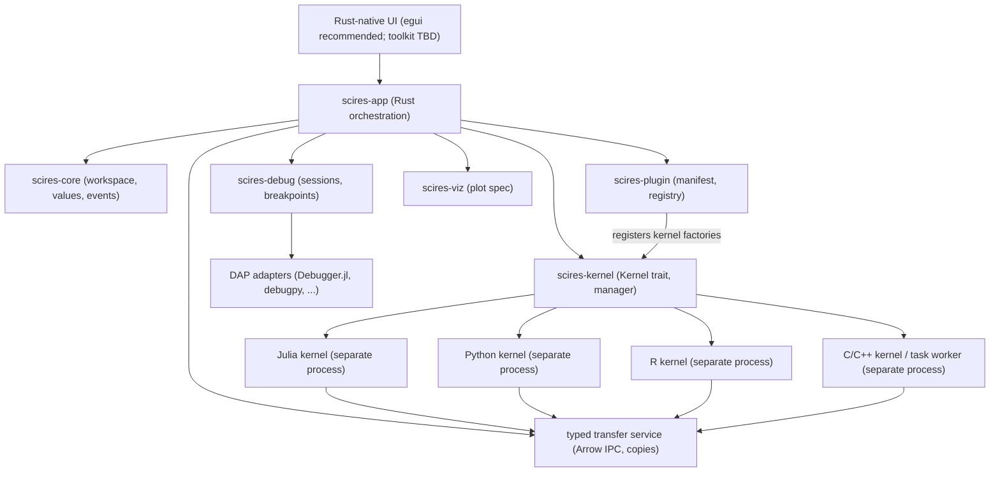
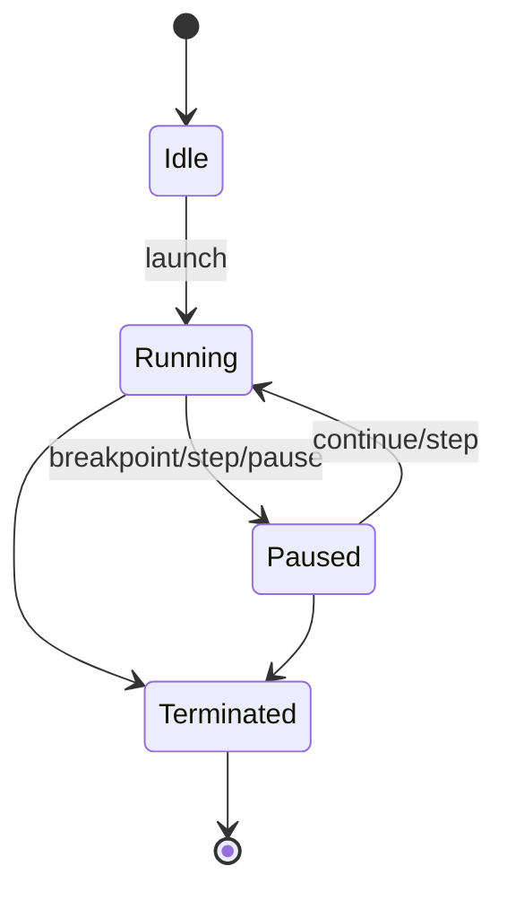

# SciRes Architecture

## 1. Principles

1. **Hexagonal / clean architecture** — domain crates have no knowledge of UI, IPC or
   language runtimes. Adapters implement traits defined in the domain.
2. **Rust-native IDE and orchestration** — the IDE shell and application orchestration
   are Rust. egui is recommended for the first native-shell spike; final toolkit
   selection remains open (ADR-0007).
3. **Process isolation for language runtimes** — the target architecture runs Julia,
   Python and R kernels, and compiled C/C++ tasks, in separate worker processes. This is
   a crash boundary, not by itself a security sandbox; only the bounded Julia reference
   supervisor exists.
4. **Versioned kernel boundary** — a versioned SciRes kernel API defines host/kernel
   capabilities. Jupyter-compatible messaging is used where it fits; small control
   messages use JSON or Protobuf.
5. **Plugins contribute; kernels execute** — plugins declare and register capabilities.
   A language kernel is a separately supervised runtime session, not the plugin's own
   execution protocol or process.
6. **Event driven** — state changes publish `DomainEvent`s; UI views subscribe.
7. **Trust is explicit** — packaging, process separation and manifest validation do not
   imply sandboxing, permissions enforcement or trust. Security policy must be explicit.

## 2. High-level view



## 3. Bounded contexts

| Context | Crate | Key concepts |
|---------|-------|--------------|
| Workspace | `scires-core` | `Workspace`, `Variable`, `Value`, `Language` |
| Execution | `scires-kernel` | `Kernel`, `KernelFactory`, `KernelManager`, `ExecuteRequest` |
| Julia adapter | `scires-julia-kernel` | Direct Rust Jupyter/ZeroMQ supervisor for the reference kernel |
| Interchange | `scires-interchange` | Versioned Arrow IPC scalar, table, tensor and CSC profile |
| Debugging | `scires-debug` | `DebugSession`, `DebugState`, `Breakpoint`, `DebugAdapter` |
| Extensibility | `scires-plugin` | `PluginManifest`, `Contributions`, `PluginRegistry` |
| Visualization | `scires-viz` | `PlotSpec`, `Layer`, `Mark`, `Renderer` |

`scires-interchange` is a boundary codec, not a domain model. It owns Arrow IPC encoding
and validation so Arrow implementation types do not leak into `scires-core::Value`,
which remains a lightweight language-neutral summary.

## 4. Polyglot model

Each language is a `Kernel` registered by a plugin through a `KernelFactory`. Rust
orchestrates a project workspace, but each kernel owns its own runtime state and variable
namespace. The workspace is not a shared variable namespace or shared heap: values move
between kernels only through explicit, typed transfer requests. `Value` summaries (type,
shape and preview) support the variable explorer; a summary is not the transferred data.

**Plugin and kernel boundary:** A plugin packages host-side contributions and may
register a `KernelFactory`; the kernel is the language runtime session supervised by the
host. The `process` plugin runtime (JSON-RPC over stdio) is not the Jupyter/SciRes kernel
protocol. A Julia adapter may be a trusted host-side integration that launches a separate
Julia process, but Julia code and project scripts must not execute inside the IDE process.
The same distinction applies to Python and R. Compiled C/C++ tasks use worker processes
and need not behave like persistent interactive REPLs; whether they share the complete
kernel API or only its task/capability subset remains open.

**Apache Arrow IPC is the preferred initial interchange representation.** Start with
copy-based transport. The initial transferable set is:

- Dense N-dimensional arrays of fixed-width numeric or Boolean values, with element type
  and shape metadata preserved.
- UTF-8 strings and rectangular tables whose columns use supported Arrow primitive types.
  Complex values are represented as a real/imaginary pair.
- Sparse matrices in compressed sparse column (CSC) form with Int64 offsets and indices,
  numeric values, shape metadata and zero-based wire indices. Arrow uses LargeList columns
  to preserve 64-bit list offsets. Do not silently densify sparse data. Language adapters
  convert between zero-based wire indices and each runtime's native index convention.

The implemented v1 profile is in `crates/scires-interchange`. It supports Arrow null,
Boolean, fixed-width integer, Float32/64, UTF-8 and component-pair complex scalar values;
Arrow tables with standard primitive, binary, temporal, decimal, list and struct types;
dense tensors with Boolean, signed/unsigned 8/16/32/64-bit, Float32/64 and Complex64/128
element types; and
numeric CSC sparse matrices. Complex scalar and tensor values use an Arrow struct with
`real` and `imaginary` components. Tensor payloads are contiguous, flattened with the first
axis varying fastest, and retain shape, dtype, optional axis names and units in the versioned
envelope. CSC columns use Int64 offsets and indices with zero-based wire indices.

Arrow validity represents missing table/scalar values; a valid NaN remains NaN. Dense
tensors reject null elements. The codec performs no dtype coercion, so unsupported and
lossy conversions fail rather than silently changing values. Dictionary, map, union and
extension table fields are not supported in v1. Runtime objects, functions, pointers,
and device-memory values are not part of the transfer model.

Custom/object values, ragged arrays, runtime objects and values without a defined mapping
remain kernel-local. They may be transferred only after an explicit user conversion;
otherwise the operation returns a clear unsupported-value error rather than silently
coercing data or sending a preview. Sparse formats that cannot be represented by the
CSC profile are likewise rejected. The codec has no lossy conversion path; any future
lossy conversion must be explicit.

Shared-memory Arrow buffers are deferred: any later adoption must follow benchmarks and
define buffer ownership, lifetime, cross-process cleanup and failure recovery first.
`tests/arrow_profile_interop.py` verifies Arrow IPC exchange between the Rust profile and
PyArrow. `tests/julia_arrow_interop.py` now verifies bidirectional Rust↔Julia Arrow IPC
for an Int32 scalar, a table preserving valid NaN versus null, a dense Int32 tensor with
axis metadata, and a Float64 CSC matrix with zero-based wire indices. The Julia fixture
converts those indices to one-based `SparseMatrixCSC` indexing; writing CSC through
Arrow.jl requires LargeList offsets. These interoperability fixtures exchange IPC stream
files and do not test a live-kernel data-plane transport.
`tests/julia_kernel_lifecycle.py` exercises IJulia through Python's Jupyter Client for
project selection, execution/output, errors, interrupt, graceful shutdown, and restart.
These tests establish only the listed
Rust/Julia Arrow and IJulia/Jupyter behaviors; they do not prove live-kernel Arrow
transport or a direct Rust Jupyter transport, and complex/more exhaustive profile
interoperability remains unverified. The separate Python-only comparison in
`tests/bench_data_exchange.py` remains exploratory performance evidence, not proof of
kernel performance.

The versioned SciRes kernel API (ADR-0002, refined in ADR-0008) is the compatibility boundary.
Jupyter-compatible messaging is used where it fits, with small JSON or Protobuf control
messages. Arrow IPC is the initial typed data representation rather than an implicit
shared namespace. Compiled C/C++ tasks run in isolated workers; the IDE must not load
arbitrary native libraries into its process.

The interchange profile serializes and decodes Arrow IPC streams in memory; process
transport for Arrow values and most language-specific adapters remain unimplemented.

**Julia reference kernel (control plane implemented; data plane pending):** ADR-0009
defines Jupyter messaging for Julia behind SciRes Kernel API v1, with Arrow IPC as a
separate typed data plane. [ADR-0010](adr/0010-direct-rust-julia-transport.md)
(**Accepted; implemented for control plane, live Arrow data plane pending**) replaced the
earlier Python `jupyter_client`/`pyzmq` bridge (`julia_bridge.py` removed) with direct
Rust Jupyter/ZeroMQ transport over pure-Rust `zeromq` and `tokio` inside
`crates/scires-julia-kernel`, keeping `scires-kernel` pure and transport-agnostic and
retaining `tests/julia_kernel_lifecycle.py` only as an external IJulia conformance
fixture. `crates/scires-julia-kernel` launches IJulia directly with an ephemeral
connection file, performs `kernel_info` handshake, correlates `RequestId` execution and
MIME outputs, advertises `interrupt: true` via the thread-safe `KernelControl` handle,
restarts, and shuts down (verified live against Julia 1.12.5 + IJulia 1.34.4). The
adapter still advertises `value_profiles: []`: live-kernel Arrow data-plane transfer
(Slice 3+), variable snapshots, remote SciRes handshake exchange, complex
interoperability, and all Python/R/C++ adapters remain unimplemented and unverified;
file-based Arrow fixtures (`tests/julia_arrow_interop.py`) do not prove live-kernel Arrow
transport.

**Generalizable kernel contract:** Julia is the first adapter candidate, not a special
shared runtime. A future adapter should negotiate the SciRes API and supported
`scires.value` profile versions, report only capabilities it implements, correlate
requests and outputs, and map execution, interruption, errors and shutdown into the host
contract. Each runtime may use a different underlying protocol; Jupyter compatibility
is an adapter choice, not a requirement imposed on every language. No Python, R or C/C++
adapter is implemented or validated by the Arrow profile.

**Project environments (proposed):** Resolve the Julia executable and project environment
explicitly and show the selected runtime/environment before starting a kernel. Prefer a
project's declared Julia environment when present, with user-level interpreter defaults
and PATH discovery as possible fallbacks; do not silently install packages or change the
project environment. Exact precedence, environment creation, version-manager support and
lockfile policy remain open. Other languages should keep their native environment models
behind their adapters rather than imposing a single cross-language package manager.

**Visualization and debugging boundaries:** Kernels may emit structured MIME output,
including the current `application/vnd.scires.plot+json` `PlotSpec`. `scires-app` should
route validated plot specifications to a contributed `Renderer`; renderer choice and
large-data handling remain separate from kernel execution. The current plot model embeds
Float64 samples and has no Arrow-backed data reference. Debugging remains a DAP client
boundary: the Julia adapter, kernel process and selected project environment must agree,
but whether a debugger launches or attaches to a kernel and how a paused session affects
console execution remain open. `scires-debug` currently provides domain state and ports,
not concrete DAP or kernel integration.

**Security and implementation status:** The manifest parser, validator and registry are
implemented; plugin loading, package installation, WASM hosting, process supervision,
trust prompts, permission enforcement and resource limits are not. `Runtime::Native` is
the current manifest deserialization default, so documentation that calls WASM the
third-party default describes a target policy, not enforced behavior. Native plugins
must be treated as trusted host code. Separate kernel or plugin processes limit crash
impact but do not prevent filesystem, network or secret access. WASM capability
restrictions, process-plugin approval, archive extraction safety, signatures and update
trust policy need implementation and threat review before third-party distribution.

## 5. Plugins

A plugin is a directory with a `scires-plugin.toml`:

```toml
id = "scires.python"
name = "Python support"
version = "0.1.0"
scires = "^0.1"
activation = ["onLanguage:python"]

[contributes]
kernels = ["python"]
commands = [{ id = "python.selectInterpreter", title = "Select Python interpreter" }]

[dependencies]
"scires.arrow" = "^0.1"
```

Target lifecycle: `Installed → Enabled → Active → (Disabled | Failed)`. Activation is
intended to be lazy (VS Code-style activation events) to keep start-up fast; the host
loader and activation runtime are not implemented.

Plugins declare a `runtime` — `declarative`, `native`, `wasm` or `process` — and may
contribute dockable `views`. WASM as the default for third-party code is a proposed host
policy, not currently enforced by the manifest parser or a runtime. See
[PLUGINS.md](PLUGINS.md) and ADR-0006 for the implementation boundary.

## 5a. UI

`scires-ui` is a pure, toolkit-agnostic model of the shell: a dock `Layout`
(`left | center | right | bottom`) of `Panel`s and `Theme` design tokens. The default
`Layout::scientific()` mirrors Spyder/RStudio: Files · Editor · Variables/Plots ·
Console/Debugger. The UI must be Rust-native. egui is recommended for a bounded first
shell spike; final toolkit and editor choices remain open (ADR-0007). The design proposal
is in [UI_UX.md](UI_UX.md).
The existing UI/UX prototype lives in Figma:
<https://www.figma.com/design/mX6AQKKVN9mkPeRU6v44k1> (Main Window, Plugin Manager),
with colour variables matching `Theme::dark()`.

## 6. Debugger

The IDE is a DAP client; each language may provide a DAP adapter (ADR-0004). A debug
session should use the same selected runtime and project environment as the kernel it
debugs, and its lifetime must be invalidated if that process exits or restarts.
`scires-debug` models breakpoints and a session state machine, but it does not yet
integrate a concrete DAP adapter with a kernel. Whether Julia debugging launches a
separate debuggee or attaches to the interactive kernel, and whether the REPL may be
used while paused, remain open.



## 7. Roadmap

| Work | Depends on / exit gate | Status |
|------|------------------------|--------|
| Core ports/mocks, plugin manifest/registry, plot model and Arrow v1 profile | Unit/schema tests and Arrow format fixture | Implemented; no concrete runtime adapter |
| Specify the versioned kernel API: handshake, capabilities, request correlation, lifecycle, errors and output events | Keep process transport and language-specific details behind adapters | API v1 contract (`RequestId`, `KernelControl`, lifecycle states, handshake validation, opaque Arrow transfer port) implemented in `scires-kernel` and `scires-app`; remote handshake exchange remains pending |
| Validate the Julia reference boundary and environment policy (ADR-0009) | Demonstrate a supported Julia/Jupyter path and real Julia Arrow/CSC conversions | Direct Rust ZeroMQ control plane verified on Julia 1.12.5 + IJulia 1.34.4; file-based scalar/table/tensor/CSC Rust↔Julia Arrow fixtures tested; live-kernel Arrow data-plane transfer unimplemented |
| Implement the Julia process supervisor and adapter (ADR-0010) | API contract and feasibility gate above; direct Rust ZeroMQ transport, environment discovery, cancellation, interrupt, restart and diagnostics | ADR-0010 control plane implemented (pure-Rust `zeromq` + `tokio`, concurrent `KernelControl::interrupt`, restart, shutdown; `julia_bridge.py` removed); live Arrow data-plane transfer (`value_profiles: []`), variable snapshots, and diagnostics/policy polish remain pending |
| Build the Rust-native workbench from the UI/UX spec | `scires-app` commands/events and stable kernel/output/transfer states | UI model only; egui recommended for first spike, no shell |
| Connect variable, plot and debug panels | Kernel summaries and MIME events; Renderer contract; DAP capability/lifecycle alignment | Domain models/ports exist; integrations unimplemented |
| Define plugin trust, runtime permissions, package/install and environment policy | Threat model, archive/signature policy and explicit process/WASM enforcement | Manifest/registry only; distribution and sandboxing unimplemented |
| Add Python and R adapters; define the C/C++ task-worker subset | Shared API conformance suite plus Julia reference implementation | Later; no interoperability claims |

UI/UX design can proceed in parallel with kernel API and Julia feasibility work; the live
shell should not assume transport-specific behavior. Third-party plugin distribution
depends on the trust and isolation policy, not merely on the manifest format.
