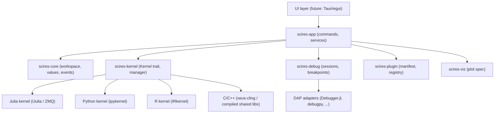
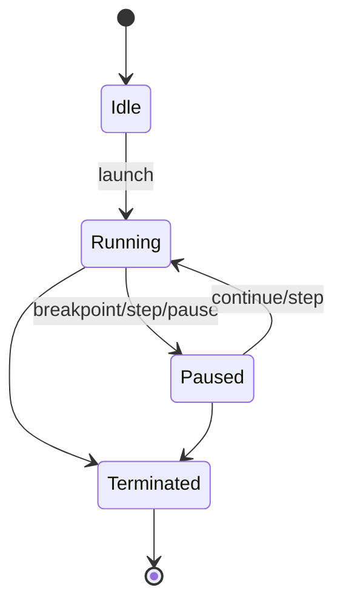

# SciRes Architecture

## 1. Principles

1. **Hexagonal / clean architecture** — domain crates have no knowledge of UI, IPC or
   language runtimes. Adapters implement traits defined in the domain.
2. **Process isolation for language runtimes** — every kernel (Julia, Python, R, C/C++)
   runs out-of-process, like Jupyter/Spyder. A crashing kernel never takes down the IDE.
3. **Standard protocols over bespoke ones** — Jupyter messaging for execution,
   Debug Adapter Protocol (DAP) for debugging, Language Server Protocol (LSP) for editing.
4. **Everything is a plugin** — built-in language support is shipped as plugins using
   the same public API as third parties (VS Code / Eclipse / JupyterLab model).
5. **Event driven** — state changes publish `DomainEvent`s; UI views subscribe.

## 2. High-level view



## 3. Bounded contexts

| Context | Crate | Key concepts |
|---------|-------|--------------|
| Workspace | `scires-core` | `Workspace`, `Variable`, `Value`, `Language` |
| Execution | `scires-kernel` | `Kernel`, `KernelFactory`, `KernelManager`, `ExecuteRequest` |
| Debugging | `scires-debug` | `DebugSession`, `DebugState`, `Breakpoint`, `DebugAdapter` |
| Extensibility | `scires-plugin` | `PluginManifest`, `Contributions`, `PluginRegistry` |
| Visualization | `scires-viz` | `PlotSpec`, `Layer`, `Mark`, `Renderer` |

## 4. Polyglot model

Each language is a `Kernel` registered by a plugin through a `KernelFactory`.
Variables are exposed to the shared workspace as `Value` *summaries* (type, shape, preview);
large data is exchanged via **Apache Arrow** (zero-copy, supported by Julia, Python, R and C++),
planned in ADR-0003.

## 5. Plugins

A plugin is a directory with a `scires-plugin.toml`:

```toml
id = "scires.python"
name = "Python support"
version = "0.1.0"
scires = "^0.1"
activation = ["onLanguage:python"]

[contributes]
kernels = ["python"]
commands = [{ id = "python.selectInterpreter", title = "Select Python interpreter" }]

[dependencies]
"scires.arrow" = "^0.1"
```

Lifecycle: `Installed → Enabled → Active → (Disabled | Failed)`. Activation is lazy
(VS Code-style activation events) to keep start-up fast.

## 6. Debugger

Modeled on Spyder/VS Code: the IDE is a DAP client; each language provides a DAP adapter.
`DebugSession` enforces a strict state machine:



## 7. Roadmap

1. ✅ Architecture & domain logic (this phase)
2. Jupyter-protocol transport (ZeroMQ) + Julia kernel adapter
3. DAP client + Debugger.jl integration
4. UI shell (Tauri or egui) with editor, console, variable explorer, plots
5. Plugin loading from disk, WASM sandboxing for untrusted plugins
