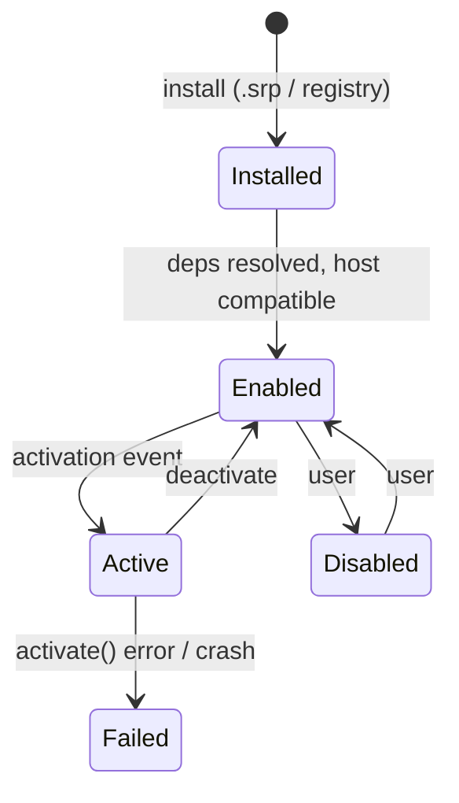

# Building SciRes Plugins

Everything in SciRes — including Julia, Python, R and C/C++ support — is a plugin.
This guide defines **what a plugin is, the four runtime kinds, and how each is built**.
Decision record: [ADR-0006](adr/0006-plugin-runtimes-and-build.md).

## 1. Anatomy

```text
acme.spectrum/
├── scires-plugin.toml   # manifest (required)
├── README.md
├── icon.svg             # 64×64, shown in the Plugin Manager
├── plugin.wasm          # entry (wasm runtime) — or bin/ executable (process runtime)
└── assets/              # snippets, themes, view definitions, sample data
```

## 2. Manifest

```toml
id          = "acme.spectrum"          # lowercase dot-separated, globally unique
name        = "Spectrum Analyzer"
version     = "0.3.0"                  # semver
scires      = "^0.1"                   # compatible host versions
description = "FFT & spectrogram tools"
runtime     = "wasm"                   # declarative | native | wasm | process
entry       = "plugin.wasm"            # required for wasm/process, forbidden for declarative
activation  = ["onLanguage:julia", "onCommand:spectrum.open"]

[contributes]
kernels     = []                       # languages provided (Kernel adapter)
debuggers   = []                       # languages with a DAP adapter
importers   = ["wav", "flac"]          # data importers by extension
visualizers = ["spectrogram"]
commands    = [{ id = "spectrum.open", title = "Open Spectrum Analyzer" }]

[[contributes.views]]
id    = "spectrum.panel"
title = "Spectrum"
area  = "right"                        # left | center | right | bottom

[dependencies]
"scires.julia" = "^0.1"
```

Validation (enforced in `scires-plugin`, all unit tested): id format, non-empty name,
no self-dependency, unique commands, `entry` rules per runtime, known view areas.

## 3. Runtime kinds

| Runtime | Built with | Trust | Use for |
|---------|-----------|-------|---------|
| `declarative` | nothing — TOML + assets | any | themes, snippets, command aliases, keymaps |
| `native` | Rust crate implementing `scires_plugin::Plugin`, linked into the host | first-party only | language packs, core tooling |
| `wasm` | any language → `wasm32-wasip2` component against `scires-plugin.wit` | untrusted (sandboxed) | **default for third parties** |
| `process` | any executable speaking JSON-RPC 2.0 over stdio | user-approved | wrapping existing tools (LSPs, DAP adapters, CLIs) |

### 3.1 Native (first-party)

```rust
use scires_plugin::{Plugin, PluginContext};

pub struct JuliaPlugin;

impl Plugin for JuliaPlugin {
    fn activate(&mut self, ctx: &mut dyn PluginContext) -> Result<(), String> {
        ctx.register_command("julia.selectEnvironment");
        Ok(())
    }
}
```

Lives in `plugins/<name>/` as a workspace crate; the host registers it statically.
Language adapters (Jupyter/ZMQ kernels, DAP clients) are native because they need I/O
that the domain crates must not perform.

### 3.2 WASM (sandboxed third-party)

```sh
cargo component new --lib acme-spectrum     # or: componentize-py, jco, TinyGo
cargo component build --release --target wasm32-wasip2
scires plugin pack ./acme-spectrum           # validates manifest → acme.spectrum-0.3.0.srp
```

The host exposes **capabilities** (WIT imports) only if declared in the manifest:
`workspace.read`, `workspace.write`, `kernel.execute`, `ui.view`, `fs.read-scoped`.
No raw filesystem or network access by default. Large data crosses the boundary as
Arrow IPC using copy-based transport initially (ADR-0003). A `ui.view` contribution is
rendered by the Rust-native shell; this manifest does not imply an HTML/webview UI. The
serialized view-content and extension contract remain to be defined.
Workspace capabilities do not create a shared kernel namespace: cross-language values
still require explicit typed transfer requests.

### 3.3 Process

Executable in `bin/<target-triple>/`. Spawned lazily on activation, killed on deactivate.
Messages: `initialize`, `activate`, `executeCommand`, `deactivate`, plus host notifications
for `DomainEvent`s the plugin subscribed to.

## 4. Lifecycle



## 5. Packaging & distribution

- **Package**: `.srp` = zip of the plugin dir + `SHA256SUMS`, optionally signed (minisign).
- **Install locations**: `<install>/plugins` (bundled), `~/.scires/plugins` (user),
  `<project>/.scires/plugins` (project-local, like Julia environments).
- **Registry**: static JSON index (Git-hosted, like Julia's General registry).

## 6. Checklist for authors

1. `scires plugin new --runtime wasm acme.foo`
2. Prefix every command / view id with your plugin id.
3. Prefer lazy activation events; avoid `onStartup`.
4. Declare the minimum capabilities.
5. `scires plugin test` then `scires plugin pack`.
