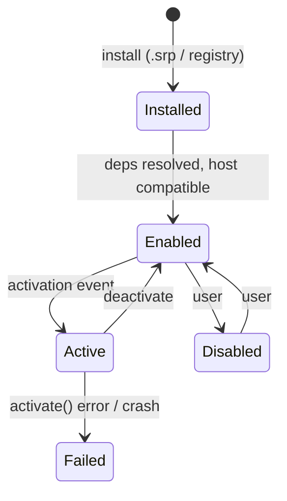

# Building SciRes Plugins

Julia, Python, R and C/C++ support are intended to be contributed through the plugin
model. A plugin packages host-side contributions; a language kernel is a distinct,
host-supervised runtime process. This guide describes the target plugin design.
Decision record: [ADR-0006](adr/0006-plugin-runtimes-and-build.md).

## Status and boundaries

The repository currently implements manifest parsing/validation and a plugin registry.
The loader, activation host, `.srp` packer/installer, registry client, WASM host and
process-plugin supervisor described below are not implemented. Treat lifecycle, packaging,
and trust statements as design intent, not available behavior.

A plugin may register a `KernelFactory`; that factory/adapter runs on the host side and
supervises a separate Julia, Python or R kernel process. A `process` plugin's JSON-RPC
entry point is a plugin protocol, not the Jupyter-compatible/SciRes kernel protocol.
Neither the plugin entry executable nor plugin runtime kind silently defines the kernel
executable or its environment.

The manifest parser defaults `runtime` to `native`. This is not a safe third-party
default. The future installer/host must explicitly enforce a trust policy, such as
requiring trusted first-party provenance for native code and refusing to assume an
untrusted executable is sandboxed merely because it runs in a child process. WASM
capability restrictions, process-plugin approval and resource limits are target
protections only until an enforcing host exists.

## 1. Anatomy

```text
acme.spectrum/
├── scires-plugin.toml   # manifest (required)
├── README.md
├── icon.svg             # 64×64, shown in the Plugin Manager
├── plugin.wasm          # entry (wasm runtime) — or bin/ executable (process runtime)
└── assets/              # snippets, themes, view definitions, sample data
```

## 2. Manifest

```toml
id          = "acme.spectrum"          # lowercase dot-separated, globally unique
name        = "Spectrum Analyzer"
version     = "0.3.0"                  # semver
scires      = "^0.1"                   # compatible host versions
description = "FFT & spectrogram tools"
runtime     = "wasm"                   # declarative | native | wasm | process
entry       = "plugin.wasm"            # required for wasm/process, forbidden for declarative
activation  = ["onLanguage:julia", "onCommand:spectrum.open"]

[contributes]
kernels     = []                       # languages provided (Kernel adapter)
debuggers   = []                       # languages with a DAP adapter
importers   = ["wav", "flac"]          # data importers by extension
visualizers = ["spectrogram"]
commands    = [{ id = "spectrum.open", title = "Open Spectrum Analyzer" }]

[[contributes.views]]
id    = "spectrum.panel"
title = "Spectrum"
area  = "right"                        # left | center | right | bottom

[dependencies]
"acme.core" = "^1.0"
```

Validation (enforced in `scires-plugin`, all unit tested): id format, non-empty name,
no self-dependency, unique commands, `entry` rules per runtime, known view areas.

## 3. Runtime kinds

| Runtime | Built with | Trust | Use for |
|---------|-----------|-------|---------|
| `declarative` | nothing — TOML + assets | no executable code; validate content | themes, snippets, command aliases, keymaps |
| `native` | Rust crate implementing `scires_plugin::Plugin`, linked into the host | first-party only | language packs, core tooling |
| `wasm` | any language → `wasm32-wasip2` component against `scires-plugin.wit` | intended sandbox for third parties, once enforced | proposed safe default after host enforcement |
| `process` | any executable speaking JSON-RPC 2.0 over stdio | intended to require explicit trust | wrapping existing tools (LSPs, DAP adapters, CLIs) |

### 3.1 Native (first-party)

```rust
use scires_plugin::{Plugin, PluginContext};

pub struct JuliaPlugin;

impl Plugin for JuliaPlugin {
    fn activate(&mut self, ctx: &mut dyn PluginContext) -> Result<(), String> {
        ctx.register_command("julia.selectEnvironment");
        Ok(())
    }
}
```

Lives in `plugins/<name>/` as a workspace crate; the host registers it statically.
Language adapters (Jupyter-compatible kernel clients, DAP clients) may be trusted
first-party Rust code because they perform I/O that domain crates must not perform. A
kernel adapter supervises the separate language process; it must not embed Julia or
execute user project code in the IDE.

### 3.2 WASM (sandboxed third-party)

```sh
cargo component new --lib acme-spectrum     # or: componentize-py, jco, TinyGo
cargo component build --release --target wasm32-wasip2
scires plugin pack ./acme-spectrum           # validates manifest → acme.spectrum-0.3.0.srp
```

The target host exposes **capabilities** (WIT imports) only if declared in the manifest:
`workspace.read`, `workspace.write`, `kernel.execute`, `ui.view`, `fs.read-scoped`.
No raw filesystem or network access by default is a proposed policy, not an implemented
guarantee. Large data is intended to cross this boundary as Arrow IPC using copy-based
transport initially (ADR-0003). A `ui.view` contribution is rendered by the Rust-native
shell; this manifest does not imply an HTML/webview UI. The serialized view-content and
extension contract remain to be defined.
Workspace capabilities do not create a shared kernel namespace: cross-language values
still require explicit typed transfer requests.

### 3.3 Process

Executable in `bin/<target-triple>/`. The target lifecycle is lazy spawn on activation and
shutdown on deactivate; it is not implemented. Messages are intended to include
`initialize`, `activate`, `executeCommand`, `deactivate`, plus host notifications for
`DomainEvent`s the plugin subscribed to. This plugin JSON-RPC channel is separate from
any kernel control or Arrow data channel.

## 4. Target lifecycle

This is the intended lifecycle; the repository does not yet load or activate plugin code.



## 5. Packaging & distribution

- **Package proposal**: `.srp` = zip of the plugin dir + `SHA256SUMS`, optionally signed
  (minisign). A checksum detects accidental corruption but is not publisher
  authentication; signer identity, trust roots, revocation and verification policy
  remain open.
- **Install locations**: `<install>/plugins` (bundled), `~/.scires/plugins` (user),
  `<project>/.scires/plugins` (project-local, like Julia environments).
- **Registry proposal**: static JSON index (Git-hosted, like Julia's General registry).

Packaging and install locations are independent of language runtime environments.
For Julia, a project may declare a `Project.toml` and `Manifest.toml`; plugin install
must not silently create or modify them. Interpreter selection, package installation,
environment locking and whether SciRes offers environment-management commands remain
open and belong to the language adapter/project policy, not `scires-plugin`.

## 6. Checklist for authors

1. `scires plugin new --runtime wasm acme.foo` (proposed CLI; not implemented)
2. Prefix every command / view id with your plugin id.
3. Prefer lazy activation events; avoid `onStartup`.
4. Declare the minimum capabilities.
5. `scires plugin test` then `scires plugin pack` (proposed CLI; not implemented).
